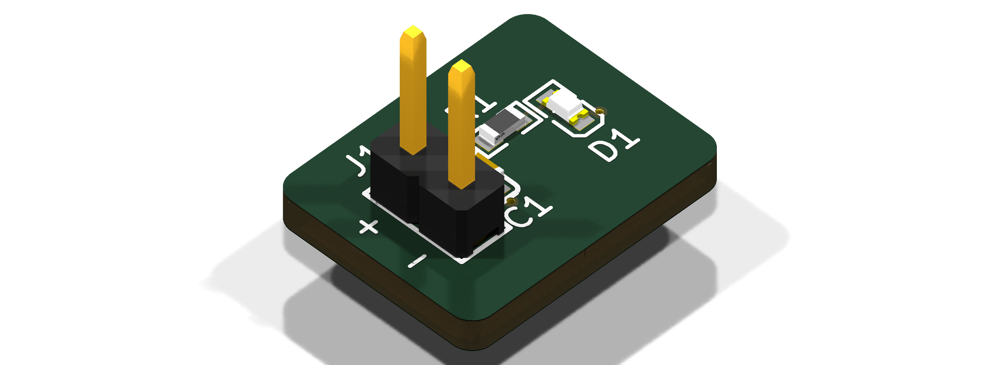

# hwde-led-test

A tiny test board that lights one green LED from 5 V. It was the first board the Hive designed with the hwde module, on 2026-10-28, to prove the pipeline runs from brief to checked fab files inside the Hive. It hasn't been ordered. Ordering is the person's call.



## What it is

- 2 layers, 1.6 mm FR-4, HASL, 13.4 x 10.5 mm, no mounting holes.
- **J1**: a 2-pin 2.54 mm header. Pin 1 (square, marked +) is +5V and pin 2 (marked −) is GND. Use 4.75–5.25 V from a bench supply or a USB 5 V lead.
- **C1**: 4.7 µF 16 V X5R 0603 across the input, next to J1.
- **R1 + D1**: a 470 Ω resistor feeds a green 0603 LED (KT-0603G). The LED runs at 3.5–4.6 mA over the input range.
- The bottom layer is a GND pour, and all parts are SMD on the top except J1.

| Ref | Part | LCSC | JLC |
|---|---|---|---|
| J1 | PZ254V-11-02P 1x2 header | C492401 | Extended |
| C1 | CL10A475KO8NNNC 4.7 µF 16 V | C19666 | Basic |
| R1 | 0603WAF4700T5E 470 Ω 1 % | C23179 | Basic |
| D1 | KT-0603G green LED | C12624 | Extended |

## Design decisions, and why

- **R1 is 470 Ω, not the 680 Ω the architecture first proposed.** The LED's listed forward voltage is 3.1 V at 5 mA, and at that voltage 680 Ω gives only 2.4–2.8 mA. 470 Ω gives 3.5–4.6 mA. The 3.1 V figure comes from the LCSC listing because the datasheet wouldn't download. If the real forward voltage is as high as 3.4 V, the current at 4.75 V input drops to about 2.8 mA, and the LED is still lit.
- **D1 is a JLC Extended part.** There is no Basic 0603 green LED, and the brief asked for 0603.
- **There is no reverse-polarity protection, as the brief asked.** A swapped lead puts up to 5.25 V reverse across D1. The silk marks + and − at J1 to make that less likely.
- **The size was earned by placement.** After placement the outline was fitted with a 2 mm margin; smaller margins clipped the refdes silk. It was then grown to 10.5 mm tall because the skill's JLC capabilities file gives 10 mm as the assembly minimum.
- **The 0603 courtyards were widened by hand to ±1.40 x ±0.70 mm.** The EasyEDA footprints came with the body outline as the courtyard.

Every decision is also in `state.json` (`decisions`), stage by stage in `log/P*-digest.md`, and with what it taught in `LEARNINGS.md`.

## The report

[`report/hwde-led-test-report.pdf`](report/hwde-led-test-report.pdf) (source: [`report/hwde-led-test-report.md`](report/hwde-led-test-report.md)) has the whole board in one place: schematic, copper layers, 3D renders, BOM and cost, every gate, the sign-offs and waivers still waiting for the person, and the run's time per stage and snags. `report/build.sh` rebuilds it.

## The checks it passed

| Gate | Result |
|---|---|
| ERC (`erc`) | 0 errors, 0 warnings |
| Placement (`place`) | pass |
| Routed DRC (`drc_routed`) | 0 errors, 0 warnings, 0 unconnected |
| Verify suite (`verify`, 14 checks) | pass, with 2 warnings: a 0.15 mm jog on /LED_A, and D1/R1 with no recognised voltage-rating attribute |
| JLC DFM on the exported Gerbers (`dfm`) | 0 findings |

A fresh-context reviewer read the schematic and the board (`reports/review-schematic.md`, `reports/review-board.md`) and found 0 errors.

## How to rebuild and re-check it

From a checkout of hive-hwde, with the module's `bin/hwde` (see `docs/README.md`):

```sh
cd boards/hwde-led-test
eval "$(../../bin/hwde env)"
PYTHONPATH=$HWDE_MODULE/scripts:$HWDE_MODULE/scripts/lib $HWDE_PY kicad/gen/root.py   # schematic + decoupling.json, rebuilt in place (keeps its UUIDs)
../../bin/hwde lib_pull --parts parts/parts.json --out-dir /tmp/pull && mkdir -p lib/aiee.3dshapes && cp /tmp/pull/aiee.3dshapes/* lib/aiee.3dshapes/   # 3D models, not committed
for g in erc place drc_routed verify dfm; do f=kicad/hwde-led-test.kicad_pcb; [ $g = erc ] && f=kicad/hwde-led-test.kicad_sch; ../../bin/hwde gate --gate $g $f --workspace .; done
../../bin/hwde fab_export --pcb kicad/hwde-led-test.kicad_pcb --out-dir fab
../../bin/hwde bom_cpl --pcb kicad/hwde-led-test.kicad_pcb --out-dir fab --parts parts/parts.json
```

The fab package is in `fab/`: `hwde-led-test_gerbers.zip`, `BOM.csv`, `CPL.csv` and `prebuy.csv`. Both Extended parts may need to be bought into JLC inventory first.

## How to test a built board

Set a bench supply to 5.0 V with a 50 mA limit and connect it to J1, + to pin 1. The supply should read about 4 mA and the LED should light green. If the LED stays dark at about 0 mA, check the polarity first.
