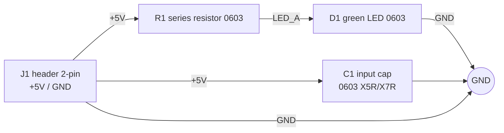

# Blocks - hwde-led-test

Power flow = signal flow: +5V from J1 passes R1 to D1 and returns to GND.

- B1 input (J1): 1x2 2.54 mm pin header, through-hole, part-class only (generic pin header, JLC basic/extended chosen at P3). Pin 1 +5V, pin 2 GND.
- B2 input cap (C1): 0603 MLCC, 4.7 uF (range 1-10 uF), >= 10 V (prefer 16 V for DC-bias derating), X5R/X7R. Placed at J1.
- B3 led-indicator (R1 + D1): R1 0603 resistor, lead value 680 R 1% (I = (5 - ~2.1)/680 = ~4.3 mA; range over 4.75-5.25 V and Vf 2.0-3.0 V is roughly 3-4.5 mA; P3 confirms against the chosen LED's Vf). D1 0603 green LED (e.g. generic 0603 green, Vf ~2.0-2.2 V). MPNs and LCSC codes are P3's job.
