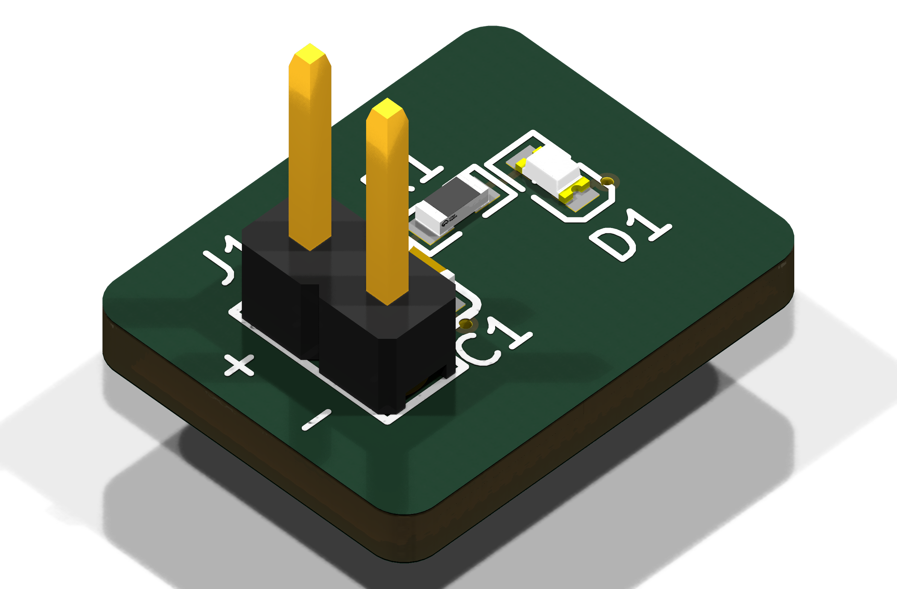
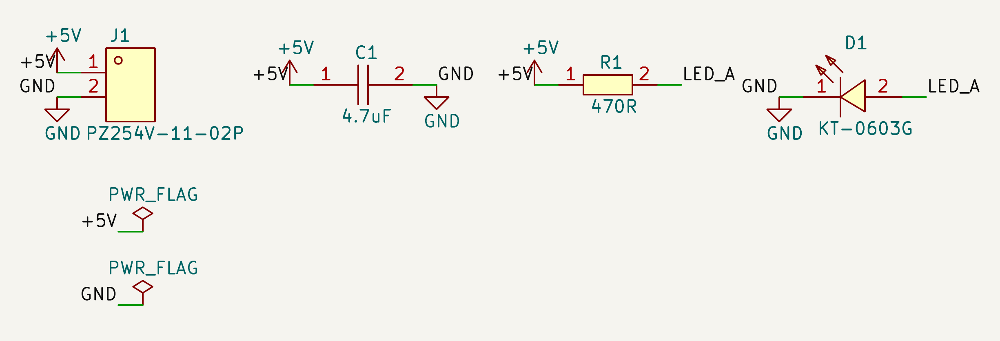
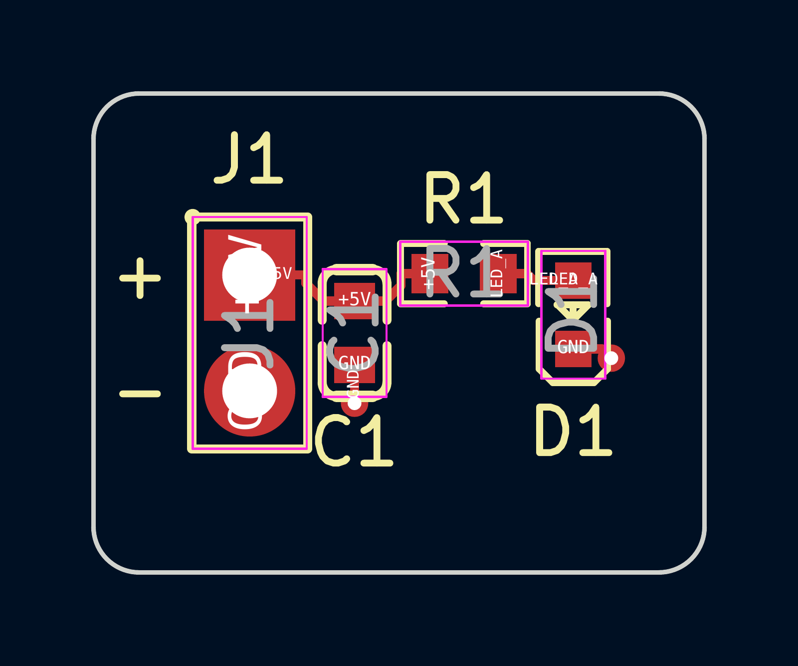
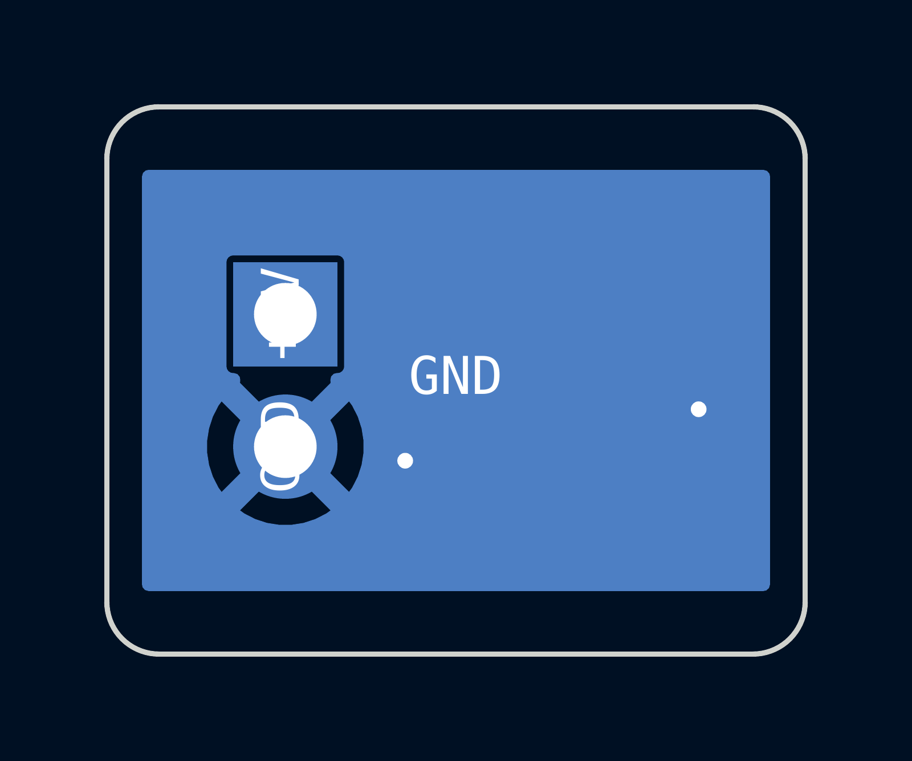
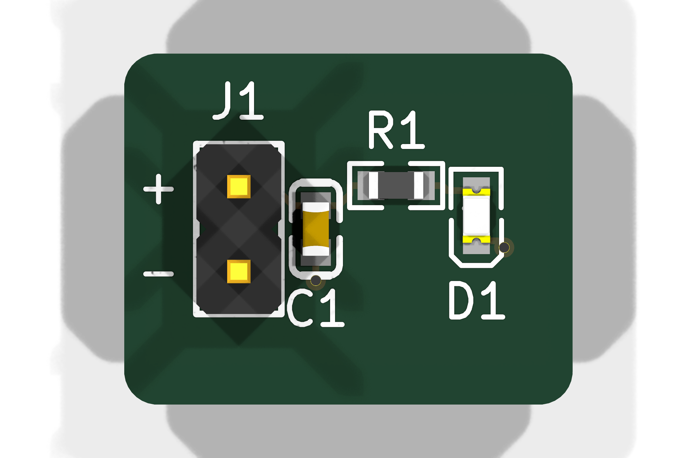
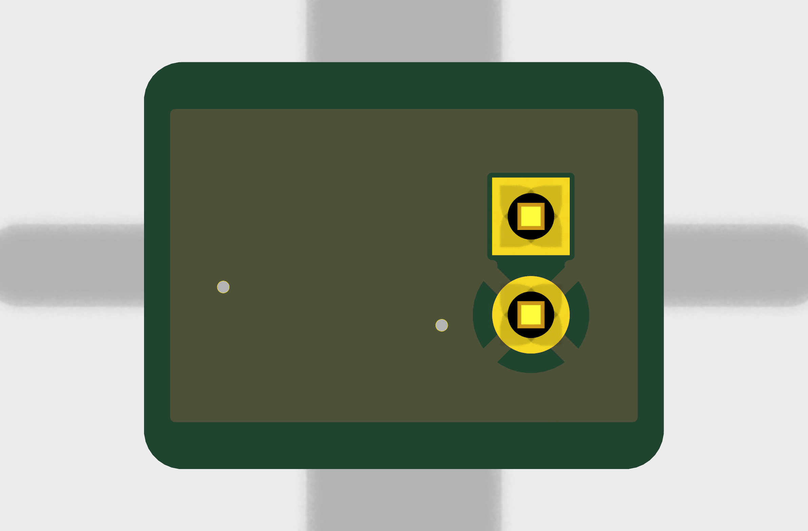

# What this is

This report covers **hwde-led-test**, a tiny 2-layer board that lights one green
LED from 5 V. It was the first board the Hive designed end to end with the
hive-hwde module, on 2026-10-28. It went from a written brief to checked fab
files in about 45 minutes, to prove the pipeline runs inside the Hive. **It has
not been ordered or quoted.** Ordering is your call.

The run went on through the stages while three sign-offs were still waiting for
your answer: H1 (architecture), H2 (schematic) and H4 (verified board). H4 also
asks you to waive two verify warnings. Those five decisions are in
[section 8](#decisions-waiting-for-you), each with what it asks and a recommended
answer. This report puts everything you need for them in one place.

| | |
|-----|------------------------------|
| Board | 2 layers, 1.6 mm FR-4, 1 oz, HASL (JLC2313), 13.4 x 10.5 mm, no holes |
| Circuit | J1 5 V header, C1 4.7 µF input cap, R1 470 Ω, D1 green 0603 LED (about 4 mA) |
| Gates | ERC, place, routed DRC, verify (14 checks), JLC DFM: **all pass** |
| Open | 2 verify warnings not waived; H1, H2 and H4 not answered |
| Parts cost | about $0.05 a board at LCSC single-piece prices (JLC fees not quoted) |
| Run time | about 45 minutes, brief to DFM-clean package; 9 subagents, 325k tokens |

{width=85%}

# What the board is

The brief asked for "a tiny 2-layer board that lights one LED from 5 V":

- **Input:** 5 V DC (4.75–5.25 V) on J1, a 2-pin 2.54 mm header. Pin 1 is +5V
  (square pad, marked **+**) and pin 2 is GND (marked **−**). It is fed from a
  bench supply or a USB 5 V lead. As the brief asked, there is no reverse-polarity
  protection.
- **C1:** 4.7 µF 16 V X5R 0603 across the input, next to J1.
- **R1 + D1:** 470 Ω feeds a green 0603 LED (KT-0603G). At the LED's listed
  forward voltage of 3.1 V, that gives 3.5 mA at 4.75 V, 4.0 mA at 5.0 V and
  4.6 mA at 5.25 V, inside the brief's 3–5 mA.
- **Layout:** all SMD parts are on top. J1 is through-hole on the left edge, and
  the bottom layer is a GND pour.
- **Built:** 5 boards if it is ever built. It is meant for room temperature on a
  bench, with no enclosure.

# Schematic

There is one sheet with four parts and three nets: +5V, GND and LED_A. ERC
reports 0 errors and 0 warnings, and a fresh-context reviewer found 0 errors
(`reports/review-schematic.md`). The full sheet is `reports/schematic.pdf`. Below
is the drawn area, cropped from that sheet.

{width=100%}

The generator first drew this sheet poorly: each net label sat on its pin
number ("+5V" ran into "1"), the circuit was small in one corner of an A4
sheet, and D1's "K" and "A" pin names printed over each other
([snag 14](#snags-the-run-hit)). `schlib` now turns every label away from
its pin, hides the pin names of two-pin parts, and sizes the paper to the
drawing (A5 here) with the drawing centred on it. The netlist and the
symbols' UUIDs didn't change.

# Layout

The board is 13.4 x 10.5 mm, with 2.0 mm corner radii. All four parts sit on
the top side in one row: J1 on the left edge, C1 beside it, then R1 and D1.
+5V runs from J1 pin 1 through C1's pad to R1. LED_A runs from R1 to D1's
anode. C1's GND and D1's cathode each drop through their own via to the bottom
GND pour, and J1 pin 2 is thermal-tied to that pour.

The two copper layer views below were made by the module's `layer_views` from
the final routed board. Net names are drawn on the copper, and both layers are
seen from the top. The vector PDFs, which stay sharp when zoomed, are
`img/hwde-led-test_F_Cu.pdf` and `img/hwde-led-test_B_Cu.pdf`.

{width=62%}

{width=62%}

The 3D renders come from KiCad 10.0.6, with the parts' EasyEDA 3D models pulled
fresh for this report:

{width=85%}

{width=85%}

# BOM and cost

| Ref | Part | Value | Package | LCSC | JLC class | Price (1 pc) |
|---|---------------|------------|------|-----|-----|-----:|
| J1 | XFCN PZ254V-11-02P | 1x2 header | 2.54 mm THT | C492401 | Extended | $0.0187 |
| C1 | Samsung CL10A475KO8NNNC | 4.7 µF 16 V X5R | 0603 | C19666 | Basic | $0.0169 |
| R1 | UNI-ROYAL 0603WAF4700T5E | 470 Ω 1 % 100 mW | 0603 | C23179 | Basic | $0.0023 |
| D1 | Hubei KENTO KT-0603G | green, Vf 3.1 V at 5 mA | 0603 | C12624 | Extended | $0.0117 |
| | | | | | **per board** | **$0.0496** |

- **Parts:** about $0.05 a board, or $0.25 for the 5 boards in the brief, at
  LCSC's single-piece prices from `parts/parts.json`. All four parts were in
  stock when sourced, with 417k to 4.8M units.
- **Fees:** the PCB, assembly and JLC's Extended-part fees were **not quoted**.
  A quote is part of P10, which is yours. DigiKey and Mouser prices weren't
  looked up because they need API keys the Hive doesn't hold.
- **Extended parts:** D1 and J1 are both Extended, so JLC charges its
  Extended-part fee for each one. They may also need buying into your JLC parts
  inventory first (`fab/prebuy.csv`). There is no Basic green LED in 0603, only
  in 0805.
- **J1 is through-hole:** the BOM of record classes J1 `tht` (it was
  `smt_placed` until [snag 13](#snags-the-run-hit) was fixed). It stays in
  `fab/BOM.csv` and `fab/CPL.csv` for JLC's THT assembly step; at order time,
  either order it as THT assembly or hand-solder it.

The fab package is in `fab/`: `hwde-led-test_gerbers.zip` (the JLC layer set
plus drill, 11 files), `BOM.csv`, `CPL.csv` and `prebuy.csv`.

# Every gate result

Each gate was run through the module's `gate` with `--workspace`, so each one
is recorded in `state.json`. The table shows the last result for each gate.

| Gate | Stage | Result | Attempts | Failed | Why a run failed |
|---------|--|-------------|--:|--:|------------|
| ERC (`erc`) | P4 | **pass**: 0 errors, 0 warnings | 4 | 0 | (re-runs after a decoupling.json change) |
| Placement (`place`) | P6 | **pass** | 6 | 1 | A centred outline grow left J1 3.0 mm from its edge (limit 2.5); restored and redone |
| Routed DRC (`drc_routed`) | P7 | **pass**: 0 errors, 0 warnings, 0 unconnected | 3 | 0 | |
| Verify suite (`verify`) | P8 | **pass**: 14 of 14 checks ran, 0 errors, **2 warnings** | 5 | 1 | check_pdn: +5V had no cap tied to it until C1 was recorded against J1.1 |
| JLC DFM (`dfm`) | P9 | **pass**: 0 findings | 1 | 0 | |

The verify suite's checks are return path, current, decoupling, diff pairs,
creepage, thermal, silk, route style, mating, PDN, ratings, BOM sync, mate pins
and 3D model paths. All of them pass except two, which give the warnings
covered in section 8. The DFM gate ran copper, copper-to-edge, drill,
hole-to-edge, silk, polarity, placement, BOM, release and castellation. Its
`placement_visual` step didn't run, and the gate isn't strict, so that didn't
fail it.

For this report, KiCad's own DRC (with schematic parity) and ERC were run again
on the committed board, and both report 0 violations. Two fresh-context
reviewers also read the design:

- **Schematic** (`reports/review-schematic.md`): 0 errors and 2 warnings.
  - The LED current is short of margin if D1's real Vf is high.
  - The LCSC field name for the BOM was wrong. It was fixed at P9.
- **Board** (`reports/review-board.md`): 0 errors and 3 warnings, all fixed.
  - The board was below JLC's 10 mm assembly minimum, so it was grown from 13.05 x 9.08 to 13.4 x 10.5 mm.
  - J1 had no polarity mark, so **+**/**−** were added.
  - The C1 label was ambiguous, so it was moved.

# Decisions made along the way

Each of these decisions is recorded in `state.json` (`decisions`) with its reason:

1. **There was no research stage (P1).** A header, a cap, a resistor and an LED
   need none.
2. **The design went ahead with a coverage gap.** hwde has no checklist for an
   LED indicator, and its rule is to research such a gap. The run skipped that
   research for a textbook LED branch and put the choice to you at H1.
3. **R1 is 470 Ω, not the 680 Ω in the H1 packet.** At D1's listed Vf of 3.1 V,
   680 Ω gives only 2.4–2.8 mA. The 3.1 V comes from LCSC's listing because the
   datasheet wouldn't download. If the real Vf is as high as 3.4 V, the current
   falls to about 2.8 mA at 4.75 V, and the LED is still lit.
4. **D1 is a JLC Extended part.** There is no Basic 0603 green LED.
5. **The 0603 courtyards were widened by hand to ±1.40 x ±0.70 mm.** The
   EasyEDA footprints used the body outline as the courtyard, which didn't
   cover the pads.
6. **D1's cathode is pad 1.** This comes from the symbol and the silk chamfer,
   not the datasheet, which wouldn't download.
7. **The outline was fitted with a 2.0 mm margin.** Margins of 1.0 and 1.5 mm
   clipped the reference text. The board was then grown to 10.5 mm tall for JLC
   assembly.
8. **The run stopped at P9.** There was no quote, no order and no board guide.

# Decisions waiting for you

This report stands in for the three sign-off packets and the two waivers. The
run went on while they were open; any "no" sends that stage back for rework.

**H1: architecture.** *Approve the architecture as is?*
The architecture is four parts on one sheet, 2 layers, JLC2313 1.6 mm HASL,
with size set by placement and no holes. The research for the LED-indicator
coverage gap was skipped (decision 2). The packet proposed R1 = 680 Ω, which
became 470 Ω at P3 (decision 3).
**Recommended: yes.** If you want a different LED colour or current, say so;
R1 and D1 are the only parts that change.
*To read:* `requirements.md`, `architecture/blocks.md`, `log/P2-digest.md`.

**H2: schematic.** *Approve the schematic?*
ERC is 0/0, the netlist audit is clean, and the reviewer found 0 errors. The
parts are J1 C492401, C1 C19666, R1 C23179 and D1 C12624. D1 and J1 are
Extended. The reviewer's two warnings are the Vf margin (decision 3) and the BOM
field name, which was fixed.
**Recommended: yes.** The sheet has been redrawn for readability (snag 14);
the netlist and board didn't change.
*To read:* `reports/schematic.pdf`, `reports/review-schematic.md`, `reports/erc-waivers.md`.

**H4: verified board.** *Approve the board as verified?*
All five gates pass on the final board (section 6), and the reviewer's 3
warnings are all fixed. The fab package is complete.
**Recommended: yes.** It's a test board and nothing is ordered. If you ever do
order it, re-check snag 13 (J1 as THT) and D1's datasheet first.
*To read:* the renders above, `reports/review-board.md`, `fab/`, `log/P8-digest.md`, `log/P9-digest.md`.

**Waiver 1: `check_route_style`, a jog on /LED_A.** *Waive it?*
There is a 0.15 mm sidestep on F.Cu at (17.06, 18.98), because R1 pad 2 (y 18.90)
and D1's anode (y 19.05) don't line up. It is cosmetic and changes nothing
electrically. The fix is to move D1 up 0.15 mm and re-route that one net.
**Recommended: waive.** Fix it if the board is touched again.

**Waiver 2: `check_ratings`, D1 and R1 have no voltage rating.** *Waive it?*
The ratings check found no voltage-rating attribute it recognises on D1 or R1.
R1 is rated 75 V, but the check doesn't read LCSC's "Voltage-Supply(Max)" field
(snag 4). D1's reverse rating is unknown without its datasheet. D1 only sees
reverse voltage, up to 5.25 V, if the leads are swapped. Green InGaN LEDs are
usually rated for 5 V reverse, and the **+**/**−** silk at J1 makes a swap less
likely.
**Recommended: waive** for a bench test board. The R1 half goes away on its own
once snag 4 is fixed.

The hive-hwde lead also asked whether to treat the board as a passed smoke test
and move on. If all five answers are yes, it is one.

# The run: time per stage

These times come from the `phase` events in `state.json`, on 2026-10-28,
local time (EDT):

| Stage | Start | Minutes | Who did it |
|---|---|--:|---|
| P0 intake | 09:25 | 1.5 | requirements-analyst (sonnet) |
| P1 research | 09:26 | 0 | none (decision 1) |
| P2 architecture | 09:26 | 2.5 | architect (sonnet) |
| P3 parts + library | 09:29 | 3.5 | part-sourcer, librarian (sonnet) |
| P4 schematic | 09:33 | 11.5 | schematic-block, schematic-reviewer (opus) |
| P5 board setup | 09:44 | 0.5 | inline |
| P6 placement | 09:45 | 10 | placement (opus) and outline fit |
| P7 routing | 09:55 | 4.5 | router (opus), freerouting |
| P8 verification | 09:59 | 7 | verify-reviewer (opus) and 3 fixes |
| P9 DFM + fab | 10:06 | 4 | inline |
| **Total** | | **about 45** | 9 subagent spawns, 324,782 tokens |

That time includes the module fixes made along the way (symdir flattening, the
3D render shim, the Xvfb GLX switch). No fix-loop budget was spent: the two gate
failures (place and verify) were each fixed directly. This run is the baseline
that later boards, starting with hifi-receiver-2, are measured against.

# Snags the run hit

These are places where hwde's own tools got in the way. Following the module's
rule, each one becomes a hive-hwde change rather than a workaround on the board.
Snags 1–12 come from the run itself and are already filed as seven briefs. Snags
13–17 turned up while making this report; 13–16 are filed as their own briefs.

| # | Where | What | Filed as |
|--:|----------|-------------------------|-------|
| 1 | `scripts/lib/env.py`, `schlib.py` | kicad-sch-api can't read KiCad 10's `.kicad_symdir` libraries; `bin/hwde` flattens them instead | 261028-141924-4dae199a93 |
| 2 | `scripts/kc.py` `render_env` | The 3D loaders are only looked for at distro paths and are missed in the AppImage; shimmed in `bin/hwde` | 261028-141924-4dae199a93 |
| 3 | `agents/part-sourcer.md` | No `refdes` or `attributes` per parts line, so the BOM had no LCSC column and ratings went unread | 261028-141930-114d313009 |
| 4 | `check_ratings.py` `V_ATTR_RE` | LCSC's "Voltage-Supply(Max)" isn't read, so R1's 75 V shows as unrated (waiver 2) | 261028-141930-114d313009 |
| 5 | `check_pdn.py` / decoupling | A board with no IC gets no cap association for its bulk cap | 261028-141930-114d313009 |
| 6 | `lib_pull.py` (EasyEDA) | 0603 courtyards are the body outline, and nothing caught it | 261028-141932-4f01e64893 |
| 7 | `board_edit.py --outline fit` | The fit margin ignores reference text, and a centred resize can push an edge connector out of tolerance | 261028-141932-4f01e64893 |
| 8 | `knowledge/checklists/` | There is no LED-indicator checklist, so every LED reads as a coverage gap | 261028-141932-9b95b3083b |
| 9 | datasheets from wmsc.lcsc.com | They arrive as a ~140-byte stub through the proxy, so there were no extractions or `fp_verify` and D1's polarity is unconfirmed | 261028-141933-6a25b2c09c |
| 10 | `kicad/gen/root.py` regeneration | New instance UUIDs break board parity | 261028-141934-60618887e0 |
| 11 | KiCadRoutingTools | It wasn't in `/hive/tools`; it is now, and the skill still has to find it | 261028-141924-4dae199a93 |
| 12 | `report_gen.py`, board guide | They need the pdf-material-builder house style, which isn't here, so this report was built with pandoc and lualatex instead | 261028-141935-42bdc24230 |
| 13 | `bom_cpl.py` assembly class | J1 (THT) is classed `smt_placed` and placed in the CPL (fixed: a `through_hole` footprint is now class `tht`) | 261028-144247-0a37b2952e |
| 14 | `kicad/gen` schematic generator | Net labels sat on pin numbers, D1's pin names overlapped, and the circuit was tiny in one corner of an A4 sheet; fixed in `schlib` (labels turn outward, 2-pin parts hide pin names, paper fits the drawing) | 261028-144249-63ddfa029b |
| 15 | `lib_pull.py` | Parts that already exist get no 3D models, so the README's "re-pull with lib_pull" fetches none, and `--overwrite` would undo the hand-widened courtyards | 261028-144250-cf7085cecf |
| 16 | `report_gen.py` file names | It looks for `verify_all.json`, `fab_export.json` and `bom_cpl.json`, but the run saved `verify-summary.json`, `fab-export.json` and `bom-cpl.json` | 261028-144253-daf2ceb304 |
| 17 | `bin/hwde` | It was committed without its execute bit, so `bin/hwde ...` fails from a fresh clone | fixed with this report |

# How this report was made

- **Renders and layer views:** the module's `layer_views`, on the committed
  `kicad/hwde-led-test.kicad_pcb`. The 3D models were pulled into a scratch
  directory with `lib_pull --out-dir` and only `aiee.3dshapes` was copied into
  `lib/` (snag 15). It stays gitignored.
- **Layer PNGs and the schematic crop:** `pdftoppm`, from the layer PDFs and
  `reports/schematic.pdf`.
- **Data:** everything else comes from the board's own records: `state.json`,
  `parts/parts.json`, `reports/`, `log/`, `fab/`, and the sign-off packets the
  run sent to the hwde lead.
- **This document:** `report/hwde-led-test-report.md` is the source. pandoc 3.9
  turned it into `hwde-led-test-report.tex`, and lualatex built
  `hwde-led-test-report.pdf` from that. The skill's own `report_gen` couldn't be
  used because it needs the house style (snag 12).
- **To rebuild:** `report/build.sh`, with pandoc on PATH.
